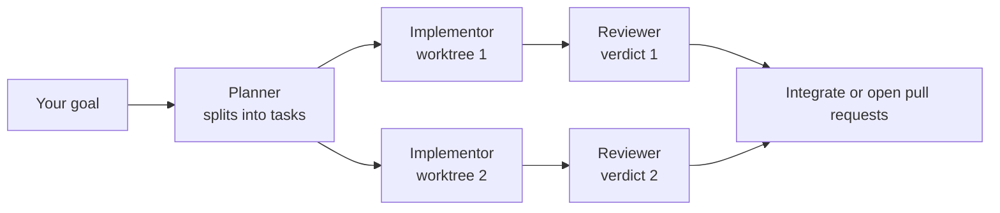

A role is a named harness, model, reasoning effort, and markdown prompt. Baton has four roles, and each one has one job in an orchestration run.

| Role | Job | Default harness and model |
|---|---|---|
| Orchestrator | Speaks to you, owns the goal, and accepts work only after the reviewer | Claude, `claude-opus-5-5` |
| Planner | Splits the goal into independent tasks and picks a harness for each | Claude, `claude-opus-5-5` |
| Implementor | Works in one worktree, runs checks, and reports what changed | Codex, `gpt-6.2-sol` |
| Reviewer | Tries to falsify the completion claim and returns a verdict | Codex, `gpt-6.2-astra` |

`/roles` shows the resolved rows for this machine, including any override you added. `baton roles --json` returns the same registry as JSON.

## How one run flows

A task starts only after every task it depends on completes. A failed or skipped dependency skips its dependents and leaves the run `partial` or `failed`.

A worker that changes files commits as `baton worker: <title>`. The reviewer reads that commit and the implementor's evidence, and returns `APPROVE` or `REQUEST_CHANGES` with concrete reasons. `/runs` opens the report where you can review, integrate, or ship each task.

## Override a role

Roles come from two places.

- `~/.baton/roles.json` sets the harness, model, and effort for a role, and declares hooks.
- `~/.baton/roles/<role>.md` replaces that role's prompt.

A malformed roles file fails closed: Baton reports the error and does not fall back to a guess. Hooks are global declarations in `roles.json`.

## Ask the orchestrator

A worker that needs a decision writes `BATON_QUESTION:` in its output. The run becomes `needs_input`, and the question appears in `/questions`. Answer it and the run continues; the answer goes back to that worker only.

## When a role is not installed

If the implementor's harness is not installed, Baton falls back to an installed harness for the worker and names the substitution in the run report. The planner receives only installed harnesses, so it cannot assign work that cannot run.

## Next

<CardGroup cols={2}>
  <Card title="Modes" icon="split" href="/concepts/modes">
    Single mode and orchestrate mode.
  </Card>
  <Card title="Worktrees and checkpoints" icon="code-branch" href="/concepts/worktrees-and-checkpoints">
    Where each worker keeps its files.
  </Card>
</CardGroup>
